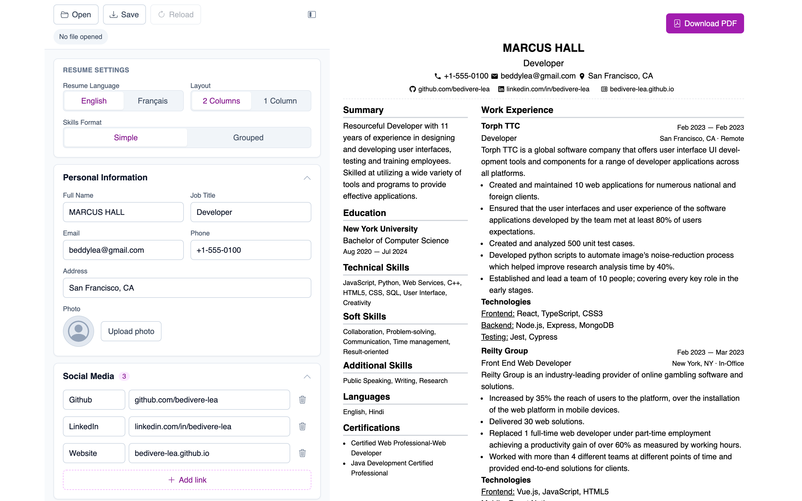
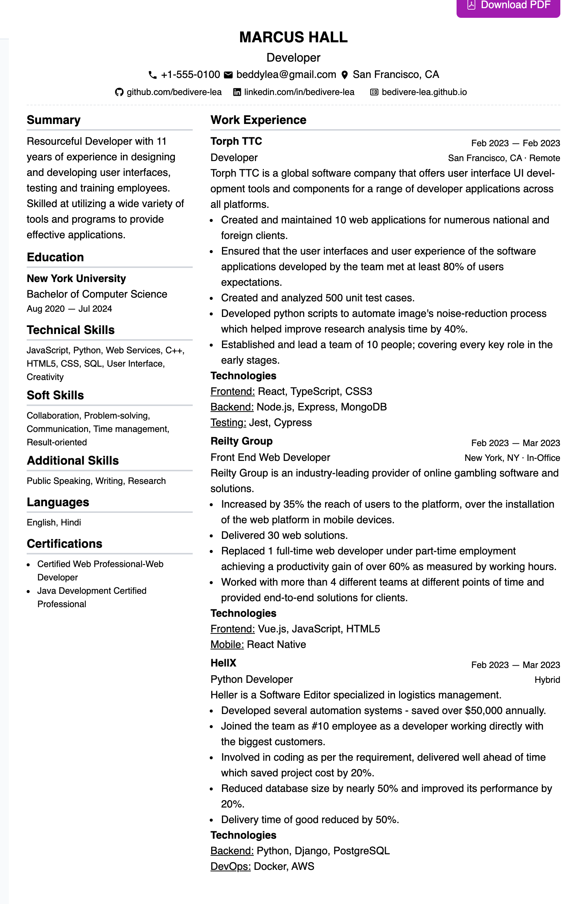
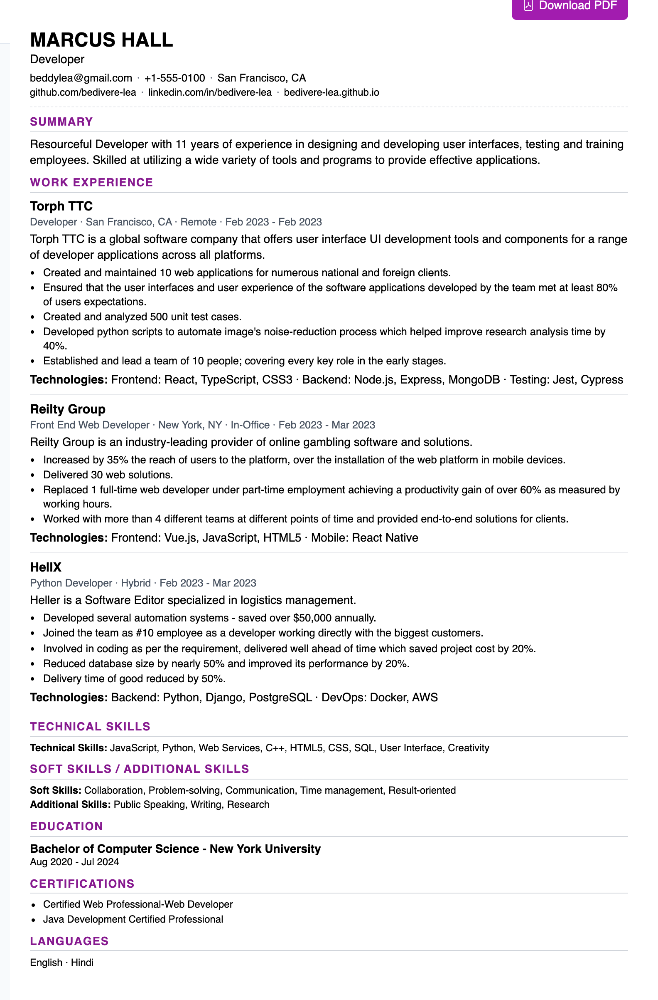

# ATSResume

A resume builder that produces clean, ATS-friendly PDFs. Edit on the left, see the page update on the right, and print.



## Two layouts

<table>
  <tr>
    <th>Two columns</th>
    <th>One column (best for ATS)</th>
  </tr>
  <tr>
    <td></td>
    <td></td>
  </tr>
</table>

Applicant tracking systems read single-column resumes most reliably. Switch layouts at any time; the content stays the same.

## Features

- **English and French resumes**: section titles, labels and dates follow the resume's language.
- **Your resume is a JSON file**: open it, edit it in the app or in your editor, and reload it in one click.
- **Grouped skills** (e.g. *Frontend: React, Vue.js*) or simple lists.
- **Work type, location and technologies** for each job.
- **Clean PDFs**: A4, no browser header or footer, saved as `Your Name - CV.pdf`.
- **Drag and drop** in the preview to reorder jobs, projects and bullet points.

## Run it

```bash
yarn install
yarn dev
```

Open <http://localhost:3000>. Or with Docker: `docker compose up --build`.

To get a PDF, click **Download PDF** and choose *Save as PDF*.

## Docs

Each feature is described in [docs/features](docs/features/README.md).

## Credits

Built on [ATSResume](https://github.com/sauravhathi/atsresume) by [Saurav Hathi](https://github.com/sauravhathi). [MIT License](LICENSE.md).
